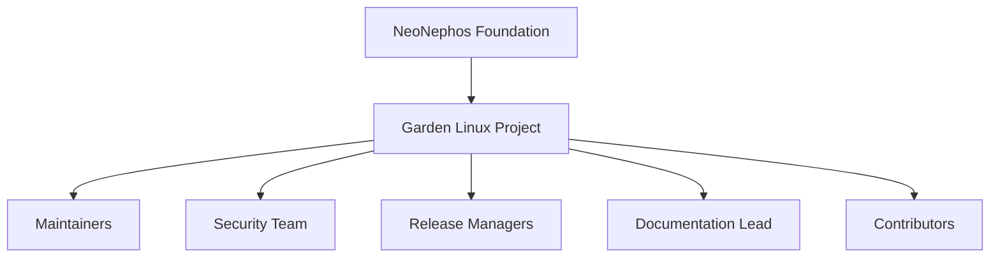

# Community

Garden Linux is an open source project developed in the open and governed through
a set of shared roles and processes. This section describes how the project is
organized and how to connect with the people behind it.

<SectionIndex />

## Organizational structure

The diagram below shows the roles described in the [Charter](./charter.md). It is
a draft and will be refined as the governance model is finalized.

| Role | Responsibility |
| --- | --- |
| Maintainers | Review and merge contributions, set technical direction, and represent the project. |
| Security Team | Coordinate private and public handling of security vulnerabilities. |
| Release Managers | Build, publish, and announce Garden Linux releases. |
| Documentation Lead | Coordinate the documentation hub and review documentation changes. |
| Contributors | Propose changes, report issues, write documentation, and participate in reviews. |

Role rosters and detailed responsibilities are maintained on the
[Members](./members.md) page and in the [Charter](./charter.md).

# Related Topics

<RelatedTopics />
